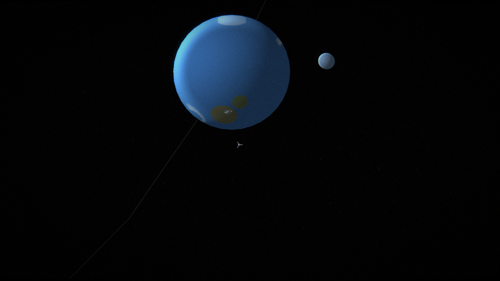
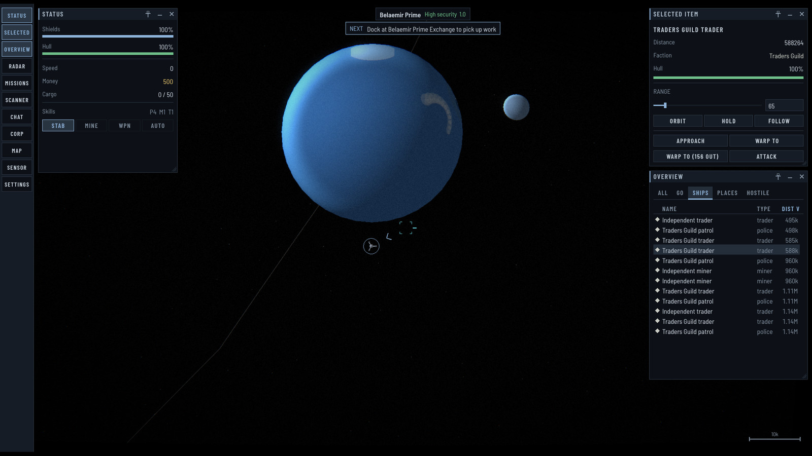
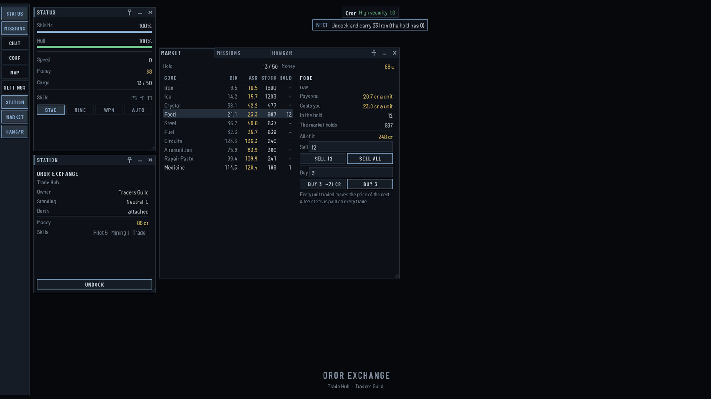
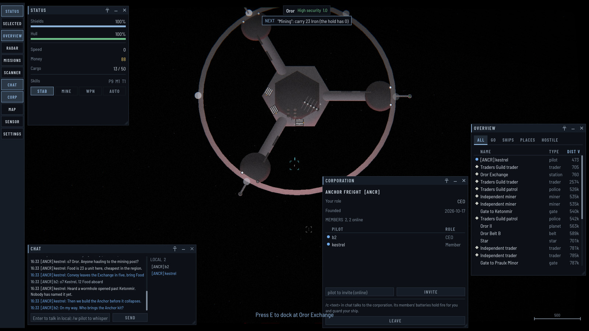
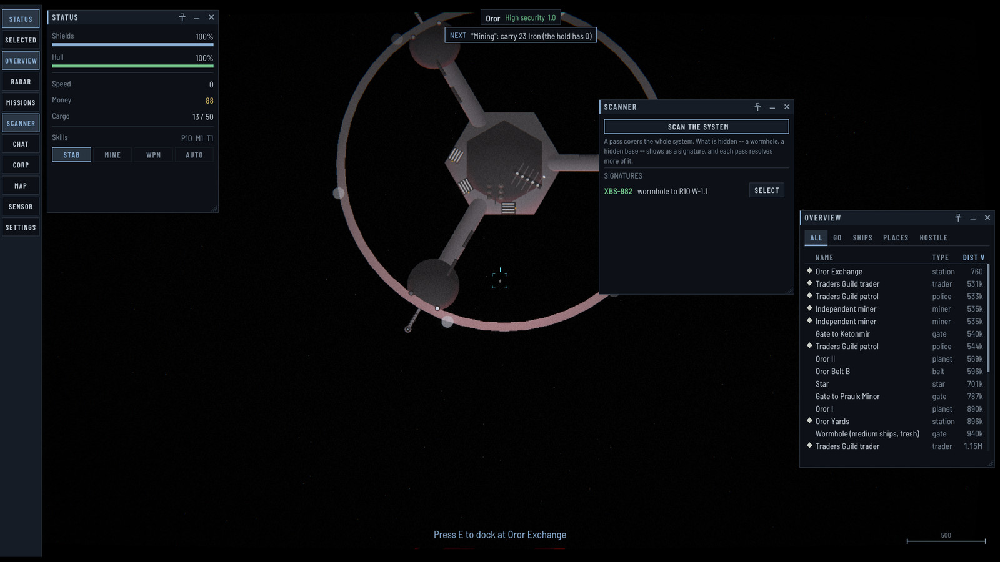
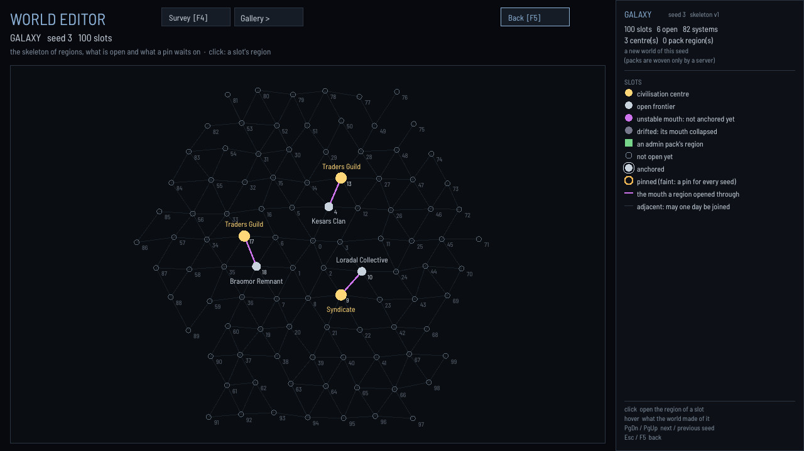

# EconSpace

**A 2D space MMO in the spirit of EVE, built in C++ on top of [raylib](https://www.raylib.com/) — where an AI agent is an ordinary player, and the world is generated rather than drawn.**

You fly a ship in a persistent galaxy: mine, trade, run missions, fight, build reputation with factions — while every system keeps simulating around you. The world lives on an authoritative server; the client renders what the server sends and sends back what you do. There is no single-player mode: playing means running a server, or connecting to one.

[](https://github.com/HEL3AN/econspace-mmo/actions/workflows/build.yml)
[](https://github.com/HEL3AN/econspace-mmo/actions/workflows/codeql.yml)


%20%7C%20Linux%20(GCC)%20%7C%20macOS%20(Clang)-lightgrey.svg)

[](https://hel3an.itch.io/econspace)

> **Status — the honest version.** EconSpace is a working **prototype**, not a finished game. The client–server core, the netcode, multiplayer, accounts and the agent interface are real and tested. The look is new and moving fast. Content is thin and there is no audio. The direction is set — see [Where it is going](#where-it-is-going) — and contributions are welcome, from people and from agents.

## Play

1. Download the latest build from [GitHub Releases](https://github.com/HEL3AN/econspace-mmo/releases/latest) or [itch.io](https://hel3an.itch.io/econspace): a zip for Windows, a tarball for Linux. Unpack it anywhere; it runs from its own folder.
2. Start a server, then connect a client to it under an account name and a secret of your choice (the first login creates the account):

```sh
./econserver host 50800                                # the world lives here
./econspace connect 127.0.0.1 50800 pilot hunter2      # in a second terminal
```

On Windows, `start-server.bat` and `connect-example.bat` in the zip do the same with a double-click. To play with friends over a network, one of you hosts: [docs/hosting.md](docs/hosting.md) is the whole guide.

A client plays only on a server of the **same release**; a mismatch is refused with the version to get. `econspace --version` says which one you have. `main` has moved well past the last release, so a server built from source does not take a downloaded client.

**Community:** questions, ideas and playtest feedback go to [Discussions](https://github.com/HEL3AN/econspace-mmo/discussions); bugs go to [Issues](https://github.com/HEL3AN/econspace-mmo/issues). What changed between releases is in [CHANGELOG.md](CHANGELOG.md).

---

## Screenshots

| | |
|---|---|
|  |  |
| An ocean world and its moon, lit by the system's own star. | The overview lists every ship in the system by distance; a selection carries its actions — orbit, warp to, attack. |
|  |  |
| Docked at a trade hub: every trade moves the price of the next. | Two pilots of a player corporation, `[ANCR]`, in local and corporation chat. |
|  |  |
| The scanner resolves a roaming wormhole into another region; until then nobody sees it. | The editor's galaxy: the skeleton of region slots a seed lays out, and the frontier open so far. |

The project page is on **[itch.io](https://hel3an.itch.io/econspace)**. More in [media/](media/). Pictures are taken by the game and the editor themselves (`--shot`, `shot`) from the 0.1 Anchor release build; the game's go through its screen treatment (`--treated`).

---

## Start here

The repository has several documents at the top. Each owns one thing:

| Read | When you want |
|---|---|
| **this README** | what EconSpace is, what works today, how to play and how to build |
| [CHANGELOG.md](CHANGELOG.md) | what changed in each release, and what has landed since the last one |
| [ARCHITECTURE.md](ARCHITECTURE.md) | how the code fits together |
| [CONTRIBUTING.md](CONTRIBUTING.md) | how to work here — build on each platform, tests, style, pull requests |
| [docs/agents/](docs/agents/) | **how to build your own bot** on the game's MCP server |
| [docs/howto/](docs/howto/) | **how to add a new kind of object** — an archetype, its shape, a material, a screen pass — worked by example |
| [documents/world_format.md](documents/world_format.md) | the contract for everything in `data/` — archetypes, shapes, materials, the screen treatment |
| [ROADMAP.md](ROADMAP.md) | where it is going, milestone by milestone |
| [DECISIONS.md](DECISIONS.md) | *why* things are the way they are — append-only, newest at the bottom |
| [docs/hosting.md](docs/hosting.md) | **how to run a server** for friends, and connect to one |
| [CLAUDE.md](CLAUDE.md), [HANDOFF.md](HANDOFF.md) | operating notes for AI agents working *in* this repository; HANDOFF.md is where a new session starts |

---

## What works today

**Playing**
- Newtonian flight with a stabilizer, autopilot, server-authoritative **warp** across systems a million units wide, and standing behaviours: **orbit**, **keep at range** and **follow** a chosen object.
- Routes planned over your own map, with EVE's preferences (shortest, safer, less secure), waypoints and favourites.
- Mining from belts that run out and grow back; a goods chain with markets whose prices follow their stock, buying and selling, and a fee on every trade.
- Ships are **designs**: refit module by module at a shipyard, save designs in a library; a lost ship is lost, and insurance pays some of it back.
- Missions, jobs posted by faction plans (supply, escort, siege) and delivery contracts from real shortages.
- One combat model for players and NPCs — traders, miners, police, pirates, warships and corporation guards all fire their design's real fit. Reputation, bounties, and PvP that is a crime under the law: criminal flags, security status, police.
- A scanner that finds roaming wormholes and hidden bases.

**Playing together**
- Many players on one server. Each connection has its own ship, account and missions; players see one another in a system; progress survives a reconnect.
- Accounts are named and have a secret. The first login sets it, and the secret never crosses the wire again: the server sends a challenge and the client answers it.
- One account, one session — logging in elsewhere displaces the earlier connection, saving it first.
- Local chat, private lines, and **corporations**: members and roles, a channel, a treasury, police and AI patrols paid for, systems held by influence and a claim.
- Players build: structures from blueprints, armed batteries with rules of engagement, outposts that grow along a chain, keep goods and dock corporation mates.

**The world generates and simulates itself**
- Each server **generates a whole world from a seed**: civilisation centres to start in, and a frontier that opens region by region as the tide rises. A new region has native factions, stations and markets from its first minute; a mouth into it stays only if someone builds an **Anchor** on it.
- Every pilot has their **own map**: the public charts, their own finds and their corporation's. Whoever reaches a system first names it, unless a faction got there before.
- An authoritative simulation on a fixed `1/60` tick, running headless in `econserver`. Factions settle, build, besiege and send convoys whether or not anyone is watching — systems with nobody in them run as arithmetic, so the world does not stop.

**The look** — generated, not drawn
- Every object is a **composition described in data**: a trade hub is a core, three arms with pads, a docking ring, lamps and a mast — and none of that is in C++.
- Lit by the system's **own stars** (two stars light a system twice), shaded by **materials** per part, and moving: rings turn, lamps blink out of step, engines burn, moons pass behind their planets, planets turn on their axes.
- A tunable **screen treatment** over the top — bloom, pixels, scanlines, grain, fringe, vignette — which you can reorder, retune or switch off in game (**F10**).

**Agents are players**
- `econagent` is an **MCP server written in C++** that is also an ordinary game client. A language model observes the world as text, gives standing orders, sleeps on an event journal and acts on what happened — by exactly the rules a human plays by. See [docs/agents/](docs/agents/).

**Tools**
- `worldeditor` — a **gallery** that shows every kind of object at once, lit and treated exactly as the game draws them, with their look editable live; a survey of generated systems; region and galaxy maps of a seed or a saved world; and editors for pins and admin packs.
- `econserver` — the same simulation, headless, with smoke tests, a console and an admin channel, `validate` for packs, and batch runs that print a world's news.
- A portable package for each release (client, server, agent and `data/` in one folder) and a guide to [hosting a server for friends](docs/hosting.md).

---

## Build from source

You need this only to work on the game, or to run what is on `main` rather than the last release.

**Requirements**
- A C++17 compiler: **MinGW-w64 g++** on Windows (from [MSYS2](https://www.msys2.org/)), **GCC** on Linux, **Apple Clang** (Xcode command-line tools) on macOS.
- CMake 3.16 or later.
- On Linux, raylib's build dependencies: `sudo apt install libasound2-dev libgl1-mesa-dev libglu1-mesa-dev libwayland-dev libx11-dev libxcursor-dev libxi-dev libxinerama-dev libxkbcommon-dev libxrandr-dev`.
- Internet on the first build: raylib 5.5, nlohmann/json 3.11.3, doctest and PicoSHA2 are fetched automatically.

```sh
cmake -S . -B build -G "MinGW Makefiles" -DCMAKE_BUILD_TYPE=Debug   # on Linux: no -G
cmake --build build                          # every target; the first build is slow
ctest --test-dir build --output-on-failure   # the unit suite
```

`build/` (Debug) is for development and tests. To play, or to measure anything, build Release in a second directory: `cmake -S . -B build-release -G "MinGW Makefiles" -DCMAKE_BUILD_TYPE=Release` and `cmake --build build-release`; an unoptimized build is several times slower. `cmake --build build-release --target dist` makes the portable package.

On Windows, close a running executable before rebuilding — Windows will not let it be overwritten. On Linux the binaries have no `.exe` suffix.

**macOS** builds and passes the tests in CI on every change, but nobody on the team plays on a Mac, so what the game *looks* like there has not been seen. Use the default generator (`cmake -S . -B build`, no `-G`). If you run it, a screenshot in an issue is the most useful thing you can send — Retina displays in particular are expected to misplace the screen treatment until #179.

## Run what you built

Two halves, both required: a server, and a client connected to it.

```sh
# terminal 1 — an authoritative server
./build/bin/server/econserver.exe host 50800

# terminal 2 — a client, under an account name and its secret (the first login sets the secret)
./build/bin/game/econspace.exe connect 127.0.0.1 50800 pilot hunter2
```

A new pilot first chooses where to begin: the capital of one of the world's civilisations (`--start random` chooses for you). A new server makes its world from a random seed the first time it starts, and keeps it in `world.json`, `regions/` and `accounts/` beside it; never commit those files.

Run more clients under other names and they share the galaxy. To play over a network, start the server with `--public` (`econserver host 50800 --public`) and connect to its address instead of `127.0.0.1`. A public server lets in only the account names listed in `allowlist.txt` beside its `world.json` (type `allow <name>` on its console; `ban <name> [reason]` and `bans.txt` keep someone out), unless it is started with `--open`. Without it the server accepts only this machine. That keeps Windows from raising a firewall prompt for every build, and nothing travels encrypted except the login. A client plays only on a server of the same release. For a server your friends play on, follow [docs/hosting.md](docs/hosting.md).

**An agent instead of a human:**

```sh
./build/bin/agent/econagent.exe connect 127.0.0.1 50800 agent its-secret
```

That process speaks MCP on stdio. To hand it to Claude Code: `claude mcp add econspace -- <path>/econagent.exe connect 127.0.0.1 50800 agent its-secret`. The full guide is [docs/agents/](docs/agents/).

**Everything else**

```sh
./build/bin/editor/worldeditor.exe                 # the world editor
./build/bin/editor/worldeditor.exe gallery shapes  # every kind of object at once (F2 backend, F10 treatment)
./build/bin/editor/worldeditor.exe gallery shapes card station.trade_hub zoom 3  # one archetype, large
./build/bin/editor/worldeditor.exe galaxy 7        # every region slot seed 7 lays out
./build/bin/editor/worldeditor.exe world build/bin/server   # a saved world, region by region

./build/bin/server/econserver.exe hosttest         # smoke tests: the server loop,
./build/bin/server/econserver.exe accttest         #   account persistence,
./build/bin/server/econserver.exe worldtest        #   galaxy persistence and the clock,
./build/bin/server/econserver.exe ordertest        #   standing orders, routes and the event journal,
./build/bin/server/econserver.exe opstest          #   server operations: init, the console, the admin channel
./build/bin/server/econserver.exe 5184000 --news   # 24 hours of an empty world, as its news
```

Every command and flag is listed in [CLAUDE.md](CLAUDE.md#build-and-run).

---

## Controls

| | Flying | | | Windows and view |
|---|---|-|---|---|
| `W` / `S` | thrust / brake | | `O` | overview — every object, by distance |
| `A` / `D` | turn | | `T` | target |
| `X` | stabilizer on / off | | `R` | radar |
| `E` | dock, when beside a station | | `J` | missions |
| `M` | mining on / off | | `G` | galaxy map |
| `F` | weapon on / off | | wheel | zoom, from a hull to a whole system |
| left click | select | | middle-drag | look away from the ship |
| right click | actions on an object — approach, **orbit**, **keep at range**, warp, dock, jump, mine | | `C` | camera back to the ship |
| | | | `V` | sensor screen — the surroundings on a grid, coloured by how you stand with them; wheel steps the range |
| | | | `P` | scanner — resolves what has a signature: roaming wormholes, hidden bases |
| | | | `N` | on the map: name the system you are in, if nobody has |
| | | | `Enter` | chat — local, a private line, or your corporation |
| | | | `Esc` | close what is on top — a menu, the map, the sensor screen, a window; it never quits |
| | | | `F10` | screen treatment settings |
| `F1` | debug: add money (a server started with `--dev` only) | | `F11` | fullscreen |
| | | | `F9` | frame cost per phase, CPU and GPU |

The right-click menu works on a row of the overview too. That is the intended way to fly: choose a thing from the list and choose what to do about it, rather than hunting for it on screen.

---

## Where it is going

Planned, not built. Details and order are in [ROADMAP.md](ROADMAP.md); the reasoning is in [DECISIONS.md](DECISIONS.md).

- **Trading charts** (#431 slice 16). What a pilot has found becomes something to sell — designed with the owner first.
- **NPCs fitted by the world** (#464). A pirate's fit follows from its gang, its wealth and where it is, not one design per role.
- **Owning and handing over structures**, the EVE way, and a corporation's enemy list with war declarations (#466).
- **A builder** (M8). Players design their own *types* of structure from the same parts the world is built from — and a design's parts decide what it can do.
- **A bigger world** (#342 S10). Scale to ten thousand systems.

---

## Repository layout

```
data/              the world as data: archetypes, modules, factions, goods, ships, blueprints,
                   world rules, pins, materials, shaders, UI themes
src/
  engine/          shared core (static library): world, entities, factions, render, UI
    gen/           the world generator: the galaxy skeleton, regions, packs, pins
  game/            the client, the authoritative Simulation and the server
    sim/           Simulation, the wire protocol, the shared player step
    net/           the TCP transport
  agent/           econagent, the MCP server
  editor/          the world editor and the gallery
tests/             the doctest suite, and a hand-written fixture world
docs/agents/       building your own bot
docs/howto/        adding a new kind of object, by example
docs/hosting.md    running a server for friends
tools/             the agent reference generator, a window capture, the release package's files
documents/         the data format, and design notes (older ones are marked historical)
```

CMake targets: **`engine`** (static library), **`netproto`** (the wire protocol and transport, compiled once), the client **`econspace`**, the server **`econserver`**, the MCP server **`econagent`**, **`worldeditor`**, and **`tests`**. `engine` depends on none of the others.

---

## Contributing

Contributions are welcome — code, world content, documentation, bug reports, and bots. Start with [CONTRIBUTING.md](CONTRIBUTING.md). Issues labelled [`good first issue`](https://github.com/HEL3AN/econspace-mmo/issues?q=is%3Aopen+label%3A%22good+first+issue%22) are small and come with a note on where to start; [`help wanted`](https://github.com/HEL3AN/econspace-mmo/issues?q=is%3Aopen+label%3A%22help+wanted%22) are larger pieces that are well scoped. Questions and ideas are welcome in [Discussions](https://github.com/HEL3AN/econspace-mmo/discussions).

Found a security problem? Please report it privately — see [SECURITY.md](SECURITY.md).

Licensed under the [MIT license](LICENSE).
